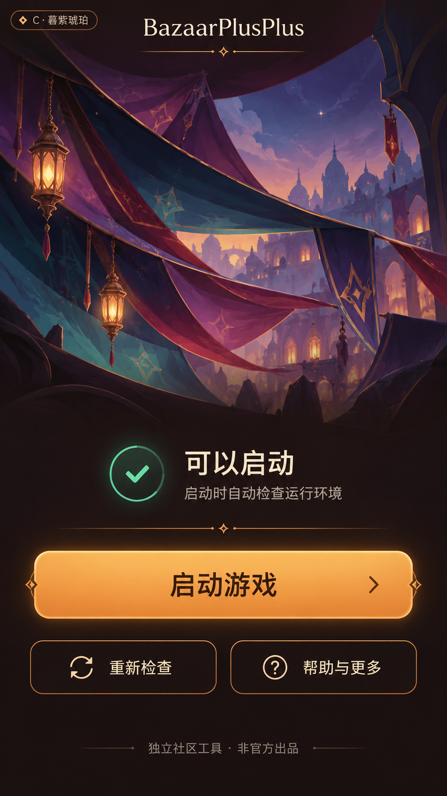

# 启动器视觉参考：C · 暮紫琥珀

用户于 2026-10-23 选定此方案作为启动器后续 UI 实现的视觉参考。
本次保存的是生成原型，尚未实现或完成安卓真机验证。

## 设计约束

- 产品品牌只展示英文 `BazaarPlusAndroid`，不使用中文插件名；如需提及游戏中文名，使用「大巴扎」。
- 暖黑底色、暮紫与青色背景氛围、奶油色文字、琥珀色主按钮；主要操作为启动游戏，次要操作为重新检查及帮助。
- 普通用户界面隐藏 debug、诊断与日志入口；开源许可说明应保持可访问。
- 原型中的「可以启动」只表示启动前的检查状态，不能用来宣称游戏登录或插件功能已经验证通过。
- 方案标记「C · 暮紫琥珀」仅用于评选，不作为实际产品 UI 文案。

## 来源与素材边界

参考 [The Bazaar 官网](https://playthebazaar.com/) 的整体色彩、明暗层次与按钮氛围，
使用内置 imagegen 生成原型。未将官网 Logo、角色或插画文件作为产品素材直接使用。
原型不代表官方出品或授权；实现时沿用独立品牌，避免复制官方专有标识、字体与插画。

生成时使用官网截图作为风格参考；完整提示词保存在
[launcher-concept-c.prompt.txt](launcher-concept-c.prompt.txt)。
背景与控件尚未拆分为可直接用于实现的素材，交互与不同屏幕适配仍须在实现阶段验证。

## 原生实现素材（2026-10-23）

`LauncherActivity` 与 `activity_launcher.xml` 使用此方案实现原生首页。
集市背景以本图为编辑参考，使用内置 imagegen 去除全部文字与控件生成，
[提示词](launcher-background.prompt.txt)保留生成约束；项目素材为
`launcher/fusionApp/src/main/res/drawable-nodpi/bpp_market_background.jpg`。
品牌、状态、分隔线与按钮均由 Android 控件和 drawable 渲染，不嵌入背景，
可随字体与可用屏宽调整并滚动。实际验证范围见[真机记录](../device-validation.md)。
