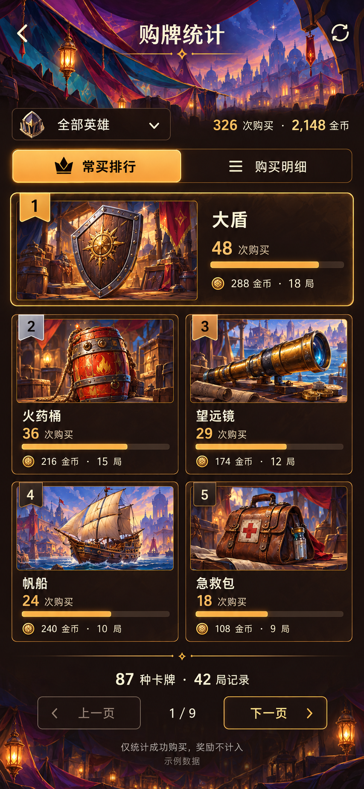

# 启动器购牌统计：卡图排行

2026-10-26 用户选定购牌统计原型中的第二张作为原生 Android 页面的视觉依据。

`LauncherPurchaseActivity` 延续集市页头、奶油文字与琥珀控件；排行首名横向突出，其余以双列卡图呈现。前三名使用 Pictogrammers Material Design Icons 的开源皇冠（金／银／铜），其后名次改为小圆标；卡片包含购买次数、相对榜首的次数条、金币花费与记录对局数。
页面复用 `HistoryReader` 的只读查询、英雄筛选和分页；点击每张卡片打开该卡的统计详情，购买明细保留单笔品质、价格、英雄、游戏天时与购买时间。原型中的数字不写入产品。

全部内容可滚动；窄屏或系统字体达到 130% 时采用单列，页头随字体增高。旋转或字体变化保存逻辑卡牌位置并映射至新行，保留筛选、页码与次数条基准；手动切换视图、筛选及刷新重置页码。

`PurchaseCardView` 只读取既有 `HistoryArtwork` 本机缓存，完整显示插画，不使用原型生成的卡图。缓存仅包含插件导出的历史模板，购买后未进入历史阵容的卡牌可能没有图片；未缓存时明确显示文字，名称和统计继续可用。不扩展游戏内缓存导出、数据库结构或采集规则。

验收状态、独立应用测试范围及正式安装边界见[真机记录](../device-validation.md)。
